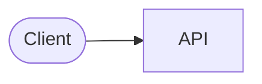

# {{TITLE}} (sdlab {{NN}})

{{ONE_LINER}}

**Headline:** _set at ship time: one measured number, such as "0 double bookings at 5k concurrent buyers"._

Part of the [System Design Lab](https://jpm-dev-14.github.io/sdlab-blog/): eleven systems built, load-tested and broken on purpose. Blog post: _linked at ship time_.

## The problem

{{PROMPT}}

## Architecture



## How it evolved

Each step is one tag and one decision record with before/after numbers.

| Tag | Change | Headline number | ADR |
| --- | --- | --- | --- |
| `v1` | Naive version | | |

## Run it

Requirements: Docker with Compose 2.34 or later, and make.

```sh
make up                   # pulls the platform images from GHCR and starts everything
open http://localhost:8080
make load PROFILE=smoke   # one-minute load test, then the invariant checker
make down
```

## Results

_Summary table and charts from [`results/`](results/), filled at ship time._

## Failure testing

_What was killed and what held: see [`chaos/`](chaos/)._

## Design docs

- [Interview design, written before any code](design/00-interview-design.md)
- [Build plan](design/build-plan.md) · [Decision records](design/adr/)
- [Retro](design/retro.md) · [Interview cheat sheet](design/cheatsheet.md)

## License

[MIT](LICENSE)
